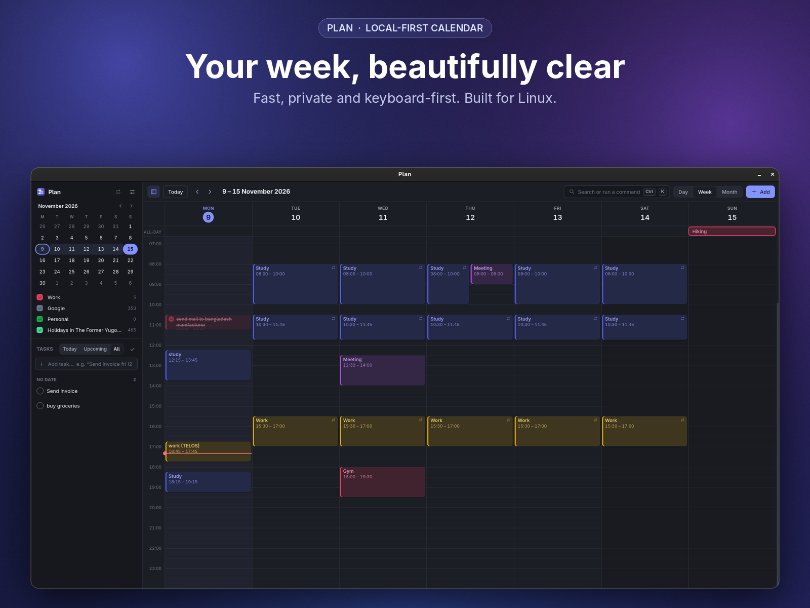
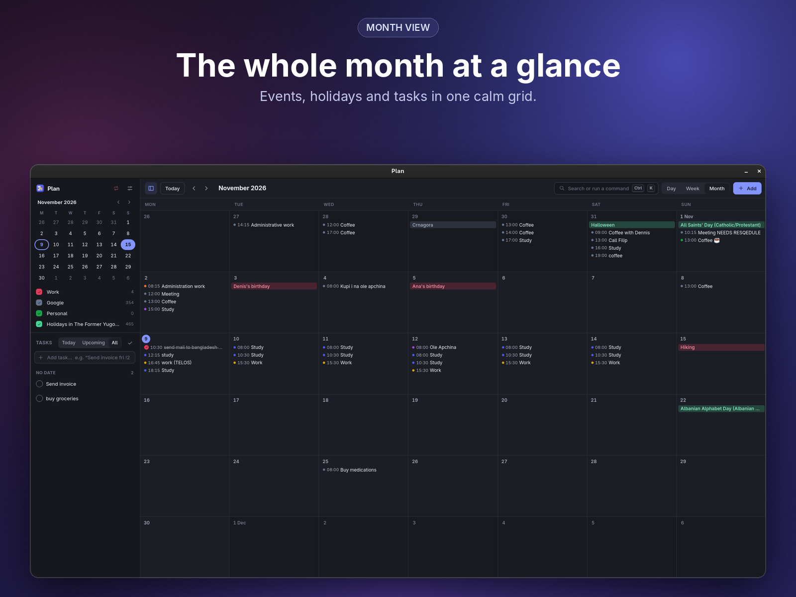
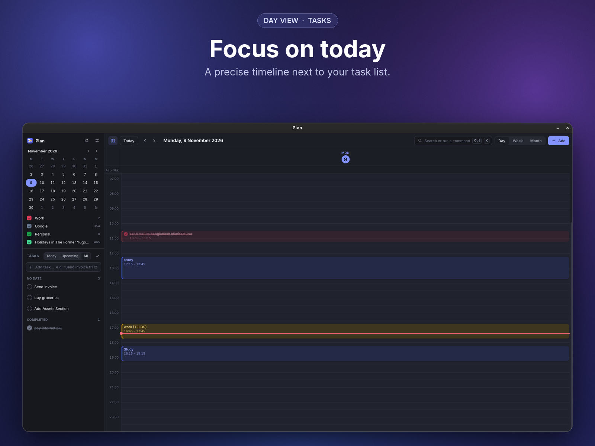
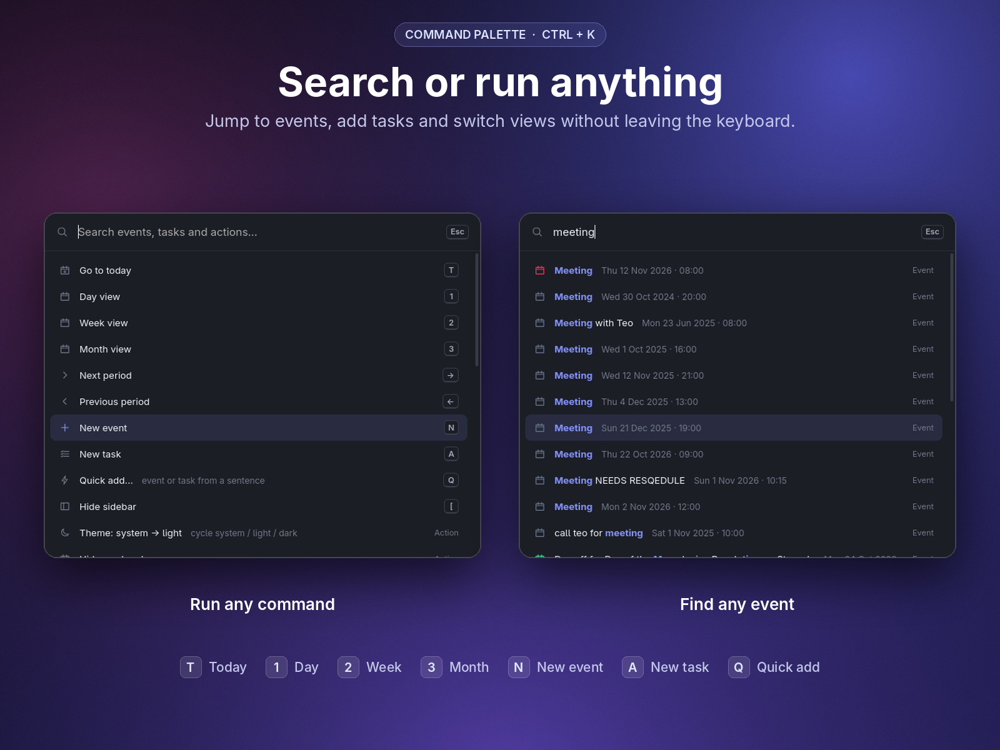
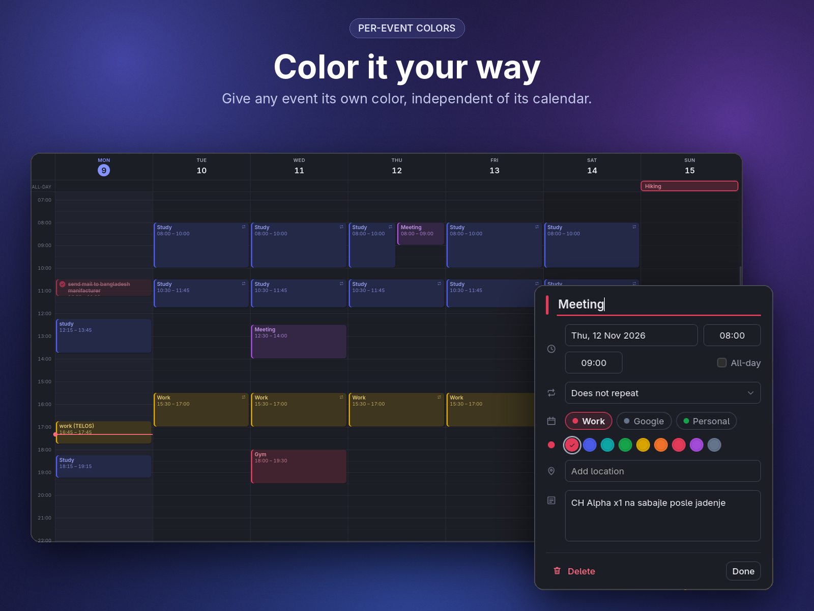
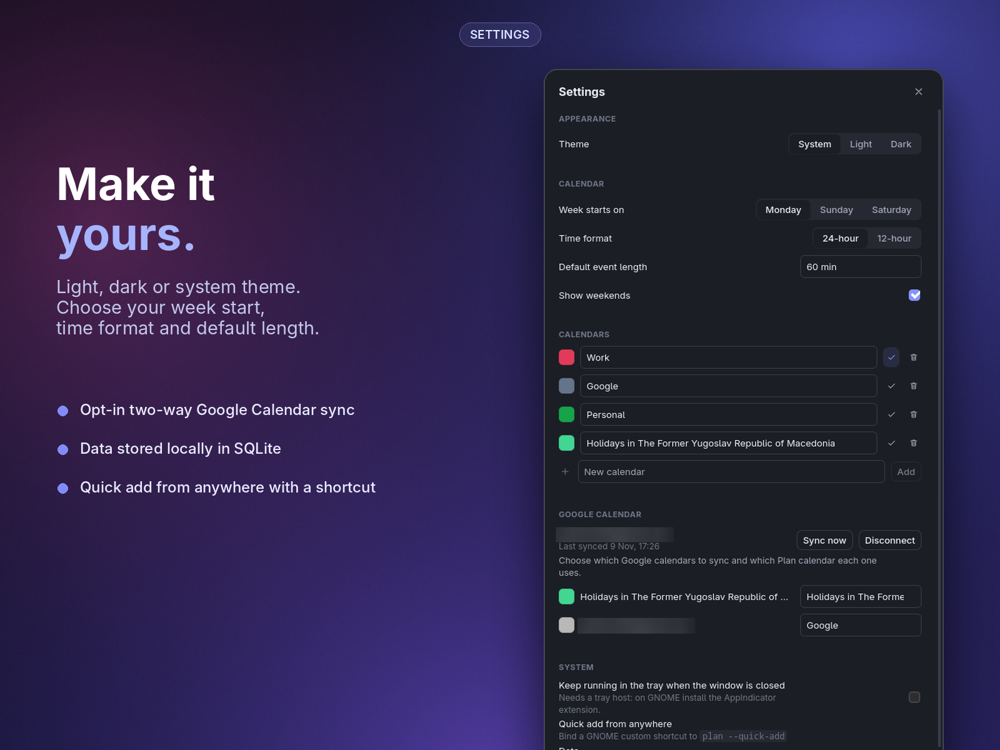

<div align="center">



# Plan

**A fast, local-first calendar and task planner for Linux.**
No accounts. No server. No paywall. Your data stays on your machine.


</div>

---

## Highlights

- **Day, week and month views** with a precise timeline, all-day row and a live current-time marker
- **Tasks beside your calendar**, grouped by Today / Upcoming / All, with natural-language entry (`Send invoice fri !2`)
- **Command palette** (`Ctrl` + `K`) to search events and tasks or run any action
- **Quick add** from anywhere with a single shortcut
- **Per-event colors**, independent of the calendar the event belongs to
- **Recurring events** and multiple calendars you can toggle on and off
- **Optional two-way Google Calendar sync**: opt-in, and Plan works fully without it
- **Light, dark or system theme**, following your desktop
- **Local-first**: everything lives in a SQLite database on your machine

## Screenshots

<table>
  <tr>
    <td width="50%"></td>
    <td width="50%"></td>
  </tr>
  <tr>
    <td align="center"><sub>Month view</sub></td>
    <td align="center"><sub>Day view with tasks</sub></td>
  </tr>
  <tr>
    <td width="50%"></td>
    <td width="50%"></td>
  </tr>
  <tr>
    <td align="center"><sub>Command palette</sub></td>
    <td align="center"><sub>Per-event colors</sub></td>
  </tr>
  <tr>
    <td colspan="2"></td>
  </tr>
  <tr>
    <td colspan="2" align="center"><sub>Settings and Google Calendar sync</sub></td>
  </tr>
</table>

Plain, unframed screenshots are in [`docs/screenshots`](docs/screenshots).

## Keyboard shortcuts

| Key | Action | Key | Action |
| --- | --- | --- | --- |
| `Ctrl` `K` | Command palette | `N` | New event |
| `T` | Go to today | `A` | New task |
| `1` / `2` / `3` | Day / Week / Month | `Q` | Quick add |
| `←` / `→` | Previous / next period | `[` | Hide sidebar |

## Quick add from anywhere

Plan uses a `--quick-add` flag with a single-instance check, so a GNOME custom shortcut can open the quick-add box even when Plan is already running.

1. Open **Settings → Keyboard → View and Customize Shortcuts → Custom Shortcuts**.
2. Add a shortcut with the command `plan --quick-add` and pick your key combination.

## Built with

- [Tauri 2](https://tauri.app) with a minimal Rust core
- [Svelte 5](https://svelte.dev) (runes), TypeScript and Vite
- Plain CSS variables, no UI library
- SQLite through `tauri-plugin-sql`, with migrations
- `date-fns` and `rrule` for dates and recurrence

## Build from source

Plan targets **Fedora with GNOME on Wayland**. Other Linux distributions may work but are untested.

**1. System dependencies (Fedora)**

```bash
sudo dnf install webkit2gtk4.1-devel openssl-devel curl wget file \
  libappindicator-gtk3-devel librsvg2-devel libxdo-devel
sudo dnf group install "c-development"
```

You also need [Node.js](https://nodejs.org) and the [Rust toolchain](https://rustup.rs).

**2. Clone and run**

```bash
git clone https://github.com/<your-username>/plan.git
cd plan
npm install
npm run tauri dev
```

**3. Production build**

```bash
npm run tauri build
```

> An RPM package is available on the [Releases](../../releases) page.

## Google Calendar sync

Sync is entirely optional. When enabled, Plan pulls events from Google and pushes your changes back. Per-event colors stay local to Plan and are never sent to Google.

## Your data

Everything is stored locally in a SQLite database (`plan.db`) in your user data directory. Plan has no server and no telemetry.

## Roadmap

- [x] **1.0.0**: per-event colors
- [ ] **1.1**: schedule view

## Known bugs

- [ ] **Quick add overflow:** the quick-add box has a visual overflow issue.
- [ ] **Modal flashing:** the screen flashes when opening modals (quick add, command palette). Still not fixed.

## License

This project is licensed under the MIT License - see the [LICENSE](LICENSE) file for details.

